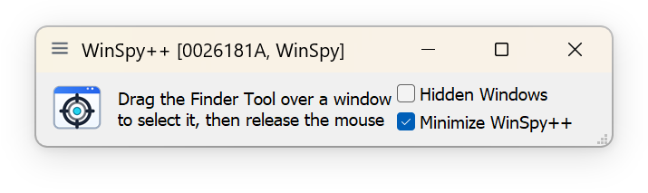

## WinSpy++
[](https://github.com/microsoft/winget-pkgs/tree/master/manifests/c/Catch22/WinSpy)

WinSpy++ is a programmer's utility for inspecting and modifying window properties of any Windows program. 


<p align="center">



</p>

## Installation

WinSpy is available via the Windows Package Manager (WinGet):

```powershell
winget install --id Catch22.WinSpy -e
```

Alternatively, download the latest x86 or x64 binaries from the
[GitHub Releases](https://github.com/strobejb/winspy/releases/latest) page.


## Building WinSpy

WinSpy can be built with a current version of Visual Studio using `WinSpy.sln`.

In Visual Studio, select the **x64** solution platform and choose a
configuration from the toolbar.

- **Release** builds the original finder with the separate cog (prototype B).
- **Release Integrated** builds the finder with the integrated dropdown (prototype A).

For command-line builds, `/p:FinderMenuVariant=A`, `/p:FinderMenuVariant=B`, and
`/p:FinderMenuVariant=C` select the integrated dropdown, cog, and stopwatch
dropdown respectively.

## Publishing a release

Publish a GitHub release tagged `vX.Y.Z` to build and upload the x86 and x64
binaries. For stable releases, the workflow then uses the uploaded executables
to generate the `Catch22.WinSpy` manifests and open a pull request in
[`microsoft/winget-pkgs`](https://github.com/microsoft/winget-pkgs).

Before the first automated submission, add a repository Actions secret named
`WINGET_CREATE_GITHUB_TOKEN` with a [classic GitHub token with the `public_repo`
scope](https://github.com/microsoft/winget-create/blob/main/doc/token.md).
If submission fails, fix the issue and rerun the **Submit WinGet update** job.

## Features

Use the finder's capture menu to inspect the window under the pointer after
3, 5, or 10 seconds. **Capture using hotkey…** registers a key or key
combination for one capture. Press it again while pointing at the target.
Opening the capture menu again cancels a pending capture. WinSpy takes a snapshot
before restoring its window so the tab contents reflect the target at capture
time. Press F5 to resume live
inspection if the window is still available. The menu also contains the
`Minimize WinSpy++` and `Hidden windows` settings for the finder.

WinSpy++ can obtain the following window properties

* Window Class and Name.
* All window styles and extended styles.
* Window properties (set using the SetProp API call).
* Complete Child and Sibling window relationships.
* Full window Class information.

Also
* Multi-monitor support!
* Retrieve passwords from password-edit controls
* Edit window styles
* View the complete system window hierarchy grouped by process


## Support

If you find this project useful, you can support continued development through [GitHub Sponsors](https://github.com/sponsors/strobejb) or [Ko-fi](https://ko-fi.com/jbcatch22).

I also do commercial development, reverse engineering and security consulting through Catch22 Solutions.

